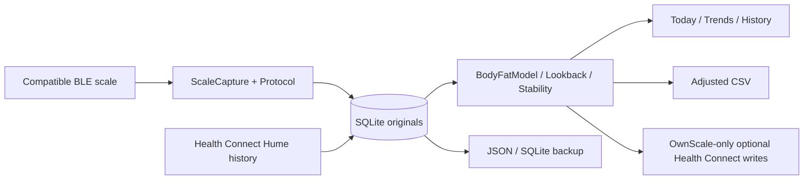

# Architecture

- `MainActivity`: native four-tab UI, permissions, tuning, export/restore.
- `ScaleCapture`: foreground BLE lifecycle, complete-session handling and idempotent saved-packet replay.
- `Protocol`: profile commands, packet validation, stable weight and impedance decoding.
- `Store`: migrations, original data, tuning versions, grouped views, backup/restore and export.
- `BodyFatModel`: experimental impedance model; `Lookback`: weight-allocation scenario.
- `Stability`: elapsed-time filtering; `TrendMath`: daily-weighted graph smoothing.
- `HealthBridge`: import and optional attributed/versioned writes.
- `ShareProvider`: read-only CSV attachment grants.
- `TrendView` / `ExpressiveIcon`: code-native charts and vector-like UI drawing.
- `tools/export.py`: desktop equivalents of adjusted views and backup serialization.

This is intentionally a small personal-scale app, not a general BLE device framework. It has no backend, login, account migration, multiple household profiles, automatic cloud backup, or automatic identity detection. The UI currently lives in one Activity; modularizing it without changing data semantics is a useful contribution.

The public edition uses its own Android application ID, generic initial model behavior, synthetic fixtures and portable tools. Personal prototype databases, keys, captures, screenshots and development history are excluded.
